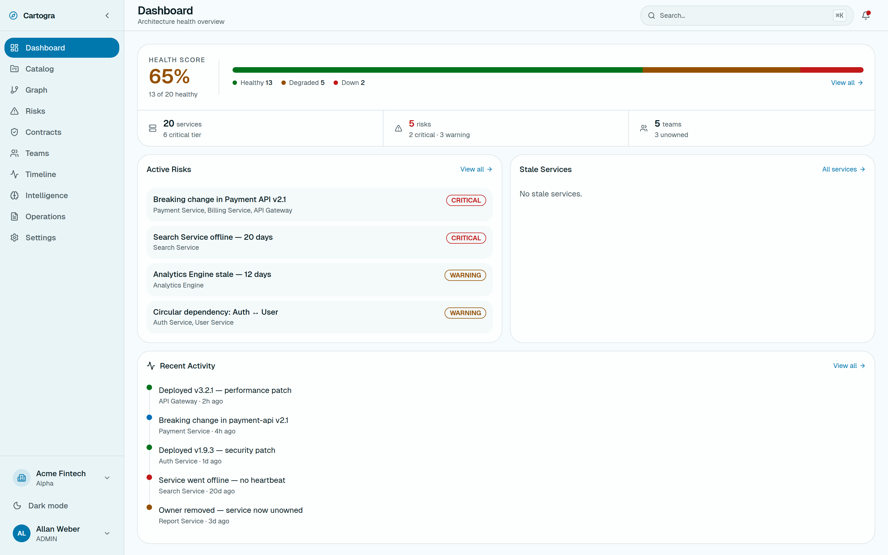

# Cartogra

[](https://github.com/allanweber/cartogra/actions/workflows/ci.yml)
[](LICENSE)

**Cartogra** is a living service registry and dependency intelligence platform for engineering teams managing distributed systems at scale.

It tracks your services, their owners, dependencies, API contracts, and health — and surfaces actionable intelligence about blast radius, breaking changes, and architectural anti-patterns.

> **Status: early — feedback welcome.** Auth, the service catalog, SCM/Kubernetes discovery and ownership work today; the dependency graph and drift detection work; contracts are in progress; intelligence is planned. Expect breaking changes before `v1.0`. Questions and ideas go to [Discussions](https://github.com/allanweber/cartogra/discussions); bugs to [Issues](https://github.com/allanweber/cartogra/issues/new/choose).



---

## Why Cartogra

Service catalogs go stale because they're updated manually. Cartogra solves this by pulling live state from your SCM providers (GitHub, Azure DevOps) and Kubernetes clusters, detecting declared vs observed dependency drift, and running AI-assisted analysis over the resulting graph.

**Core pillars:**

- **Registry** — authoritative source of truth for services, teams, and ownership
- **Topology** — dependency graph with blast radius, cycle, and SPOF detection
- **Contracts** — breaking-change detection and consumer-producer compatibility matrix
- **Intelligence** — natural language queries and anti-pattern analysis powered by Claude

---

## Services

| Service | Port | Role |
| ------- | ---- | ---- |
| `gateway` | 8080 | Auth, routing, tenant injection, rate limiting |
| `registry` | 8081 | Service CRUD, team ownership, temporal history |
| `topology` | 8082 | Dependency graph, blast radius, cycle detection |
| `contract` | 8083 | Contract validation, breaking-change detection |
| `intelligence` | 8084 | NL queries, health score, anti-pattern analysis _(planned)_ |
| `ingestion` | 8085 | SCM/K8s sync workers, webhook receivers |
| `frontend` | 3006 | TanStack Start web app |

---

## Quickstart

**Prerequisites:** Docker, JDK 25, Node 22, pnpm

```bash
cp .env.example .env    # set JWT_SECRET, INTERNAL_TOKEN_KEY, CLUSTER_CREDENTIALS_KEY
docker compose -f infra/docker-compose/docker-compose.dev.yml up -d
set -a; . ./.env; set +a
./gradlew bootRun       # all services
cd frontend && pnpm install && pnpm dev    # second terminal
```

Open [http://localhost:3006](http://localhost:3006). Locally, sign-up emails are not sent: the verification code
appears in the `./gradlew bootRun` output as `[TEST MODE] Verification OTP`.

Full setup, ports, env vars and troubleshooting: [docs/runbooks/local-development.md](docs/runbooks/local-development.md).
Production deploy: [docs/runbooks/deployment.md](docs/runbooks/deployment.md).

---

## Project Board

Track progress and upcoming work on the [Cartogra Roadmap](https://github.com/users/allanweber/projects/5) (GitHub Projects v2).

---

## Documentation

| Doc | Purpose |
| --- | ------- |
| [docs/architecture/system-overview.md](docs/architecture/system-overview.md) | Architecture and service map |
| [docs/architecture/data-model.md](docs/architecture/data-model.md) | Database schema per service |
| [docs/architecture/kafka-topics.md](docs/architecture/kafka-topics.md) | Kafka topic inventory |
| [docs/api/](docs/api/) | OpenAPI specs per service |
| [docs/adr/](docs/adr/) | Architecture Decision Records |
| [docs/runbooks/](docs/runbooks/) | Local development, deployment, connections, incidents |
| [docs/roadmap.md](docs/roadmap.md) | Roadmap |
| [CLAUDE.md](CLAUDE.md) + [.claude/rules/](.claude/rules/) | Project rules for humans and AI agents |
| [CONTRIBUTING.md](CONTRIBUTING.md) | How to contribute |

---

## Tech Stack

Java 25 · Spring Boot 4 · Spring Data JDBC · PostgreSQL · Apache Kafka · Valkey · OpenTelemetry · TanStack Start · shadcn/ui · D3

## Skills

```bash
npx impeccable install
npx skills add shadcn/improve
npx skills add https://github.com/mattpocock/skills --skill improve-codebase-architecture
```

Pinned versions and the full gate-tooling provenance table live in [`CONTRIBUTING.md`](CONTRIBUTING.md#gate-tooling).

---

## License

Apache 2.0 — see [LICENSE](LICENSE).

The core stays Apache 2.0. Future enterprise-only features, if any, will live in a separate `ee/` directory under its own license; the core always builds and runs without it. See [ADR-0031](docs/adr/0031-apache-2-core-hosted-first-monetization.md).
